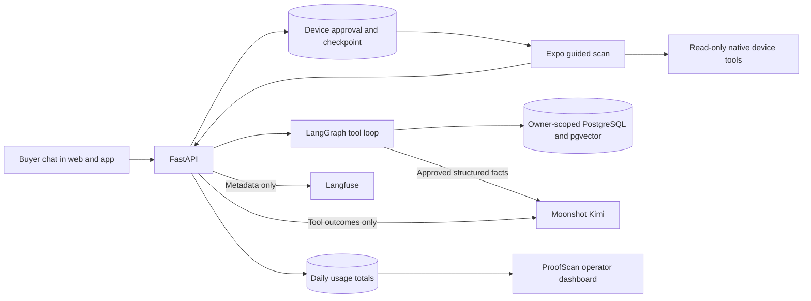

# ProofScan agents

**Buyer chat** compares the signed reports shared with a buyer and can include that buyer’s saved listings. **Guided scan** selects approved local device checks in Expo. The verification service controls consent, report sharing, and signatures.



## Buyer chat

1. Open **Buyer chat** in the web or app workspace and sign in. The default pool is the signed reports sellers shared with your account.
2. Ask a question such as “Which of these phones has the healthiest battery?” Choose a category and, if relevant, a budget and currency. If you want to include your own listings, select **Include saved listings**.
3. Open the cited reports to review the measurements and exterior evidence. Local ranking can order results by measured battery health, memory or storage and calls out missing measurements. A follow-up can refine the last question. The transcript stays in the current client session.
4. Opt into Moonshot for structured comparison. Local ranking is available by default.

Sharing creates the searchable report entry in the same database transaction. Existing valid shared reports are backfilled in batches when their owner first uses chat. Pending, declined, simulated and invalidated reports are excluded. Invalidating a report removes the entry and its vector. Budget filtering uses the upper bound of a stored comparable price estimate when available. Inspect the source report for the full estimate or an explanation of missing data.

The automatic index contains a scrubbed manufacturer and model, the device category, measured RAM, storage and battery health when available, claim mismatch and photo counts, and any supported price estimate. It excludes the report label and notes, identifiers, images, and guest links. Moonshot receives predefined preference labels and structured comparison facts after opt-in. Free-text questions, listing text, private URLs and photos stay inside ProofScan. The private report remains governed by the buyer’s existing account authorization.

### Reasoning, actions, and safeguards

The LangGraph ReAct loop alternates between a typed decision and a tool observation. K3 returns a decision through a required function call. The graph supports the following actions.

| Action | Application policy |
| --- | --- |
| `search_catalog` | The application always runs it first. PostgreSQL binds the signed-in owner, evidence source, device category, currency, and budget before ranking. |
| `compare_candidates` | Compares records already retrieved within the current request. |
| `recommend` | Accepts only candidate numbers from the current retrieval. ProofScan writes the explanation from the recorded measurements and applies deterministic numeric ranking for a requested measurement. |
| `clarify` | Offers a fixed prompt for the user to identify a priority. |

The provider boundary enforces explicit approval, a ten-second timeout per call, a 24-second decision window, and output limits. Buyer Chat can make up to two model calls after it retrieves evidence, to compare or select candidates. Unsupported actions, invalid source references, and provider errors use deterministic fallback behavior. A PostgreSQL quota reservation is committed before contacting Moonshot. Execution records contain status and tool metadata. The hourly worker clears older execution records.

Text mode uses PostgreSQL lexical ranking. Semantic mode stores 384-dimensional FastEmbed vectors in pgvector. It filters eligible records before exact cosine similarity and combines that score with a lexical signal. New report vectors are built locally during retrieval in bounded batches. The reindex command also fills missing vectors. [pgvector filtering and exact search](https://github.com/pgvector/pgvector#filtering) · [FastEmbed model list](https://qdrant.github.io/fastembed/examples/Supported_Models/)

## Capture guidance and operator usage

New purchase checks require internal readings and clear front and back photos. The buyer can create a private pickup recheck from the original signed report. At handoff and return, ProofScan suggests the next view, checks uploaded photo quality and shows matching-angle feedback. See the [capture and recheck walkthrough](../ux/flows.md#picture-guidance-and-pickup-rechecks).

The operator dashboard shows totals over the latest 30 UTC days for requests, completed responses or checks, model calls, and token usage. The breakdown covers buyer chat, guided device checks, purchase photos and handoff photos. The daily counters contain no account identifiers, questions, model responses or images. Operator access requires the existing admin role. The dashboard works with Langfuse disabled.

## Guided scan

1. In Expo, open **Scan device** and paste the original seller link. Give the normal seller consent.
2. Select **Plan guided scan**. Review the proposed scope and select **Approve checks and collect**. You can skip the plan or choose basic collection.
3. The client performs an approved local reader and reports the outcome. The planner uses available tools and earlier outcomes to select the next action. An unavailable model name can trigger an alternate lookup for the operating system’s product code.
4. Review the actual readings before deciding whether to share the report.

The approval, current tool, and revision are checkpointed in PostgreSQL. The server reserves an execution revision before inference and rechecks guest authorization before applying the decision. A short processing lease permits a restart after an interruption. The model receives the platform, approved tool names, and outcome labels. Actual readings go through the existing ProofScan scan API. The tool registry contains fixed, read-only functions. The Windows collector still runs its fixed local CIM fallbacks, including an alternate model lookup. Guided execution is wired into the Android and iOS client.

## Setup

### Base API and Moonshot

Run `uv sync --locked --python 3.12 --no-install-project` and `uv run --no-sync alembic upgrade head` from the repository root.

Put `KIMI_API_KEY` in the ignored server environment. The default provider origin is `https://api.moonshot.ai/v1`. `AGENT_MODEL` defaults to `kimi-k3` with low reasoning effort. `AGENT_TEST_MODEL` defaults to `kimi-k2.6` for a small synthetic test. K2.6 needs access on your account and can be overridden when K2 is retired. The existing listing extraction endpoint uses `KIMI_MODEL`. [Kimi model list](https://platform.kimi.ai/docs/models) · [Kimi pricing and availability](https://platform.kimi.ai/docs/pricing/chat)

Set `PYTHONPATH=apps/api` in the process. In PowerShell use `$env:PYTHONPATH = "apps/api"`. Run the cheap synthetic probe, or add `--production` to test `AGENT_MODEL`.

```sh
uv run --no-sync python -m proofscan.agent probe
```

### Semantic retrieval on host PostgreSQL

Install pgvector for your PostgreSQL major version. Provision it in the same database after applying Alembic. The provisioning SQL expects the extension in `public` and resolves the catalog using the configured database search path. If the API and worker use roles separate from the table owner, configure database grants and row-level policies for those server roles on the protected tables they use. Keep the browser-facing roles excluded.

```sh
uv sync --locked --extra agent --python 3.12 --no-install-project
uv run --no-sync alembic upgrade head
psql -h 127.0.0.1 -U YOUR_MIGRATION_ROLE -d YOUR_DATABASE -v ON_ERROR_STOP=1 -f infrastructure/postgres/enable_agent_vectors.sql
uv run --no-sync python -m proofscan.agent warm
uv run --no-sync python -m proofscan.agent reindex
```

The last two commands need `PYTHONPATH=apps/api`. `warm` caches the public `BAAI/bge-small-en-v1.5` embedding model in `AGENT_EMBEDDING_CACHE` and runs a synthetic inference. `reindex` backfills existing catalog entries. Set `AGENT_VECTOR_ENABLED=true` and restart the API. If the model or vector table is unavailable, Buyer Chat uses text ranking with the same access and budget filters. The response reports the ranking mode used.

### Semantic retrieval with Compose

For a fresh database, set `PROOFSCAN_POSTGRES_IMAGE=pgvector/pgvector:pg17`. Set `PROOFSCAN_INSTALL_AGENT=true` to install the optional agent dependencies in the API image. Plan a compatible migration or restore for any existing database volume before changing its image. Start with semantic mode off, build the stack and let the initializer migrate the database.

```bash
docker compose exec -T db sh -c 'psql -U "$POSTGRES_USER" -d "$POSTGRES_DB" -v ON_ERROR_STOP=1' < infrastructure/postgres/enable_agent_vectors.sql
docker compose run --rm --no-deps api python -m proofscan.agent warm
docker compose run --rm --no-deps api python -m proofscan.agent reindex
```

In PowerShell, use `Get-Content -Raw infrastructure/postgres/enable_agent_vectors.sql | docker compose exec -T db sh -c 'psql -U "$POSTGRES_USER" -d "$POSTGRES_DB" -v ON_ERROR_STOP=1'` for the SQL step. Set `AGENT_VECTOR_ENABLED=true` and run `docker compose up -d`. The cache volume is shared by the warming command and the API.

### Langfuse

Install the optional `agent` extra or the matching API image. Set `LANGFUSE_BASE_URL`, `LANGFUSE_PUBLIC_KEY`, and `LANGFUSE_SECRET_KEY` in the server environment. Restart the API and run a recommendation or guided scan. Look for `proofscan.recommendation` or `proofscan.device` in the configured project’s observations.

Telemetry carries execution ID, model, token counts, tool, outcome, and duration. Questions, prompts, catalog content, measurements, guest credentials, and model responses are excluded. Failed export leaves the app available. [Langfuse Python SDK](https://python.reference.langfuse.com/langfuse)

## API and tests

| Route | Use |
| --- | --- |
| `GET /api/v1/agent/catalog` | List private catalog entries, 30 per page using `offset`. |
| `POST /api/v1/agent/catalog` | Add an owned catalog entry and its vector when enabled. |
| `DELETE /api/v1/agent/catalog/{id}` | Remove an owned entry and its vector. |
| `POST /api/v1/agent/ask` | Ask with an optional budget, report-only filter, previous question and explicit model permission. |
| `GET /api/v1/admin/agent-usage` | Read 30 UTC days of aggregate usage as an operator. |
| `POST /api/v1/verifications/{verification_id}/recheck` | Create an owner-only private pickup check from a valid device report. |
| `POST /api/v1/guest/{verification_id}/agent/plan` | Pause for approval on an active mobile scan. |
| `POST /api/v1/guest/{verification_id}/agent/plan/{id}` | Submit approval, skip, or report the last tool outcome with the current revision. |

Run `uv run --no-sync pytest -q` with `TEST_DATABASE_URL` set to a disposable test database. Install pgvector in that database and set `TEST_AGENT_VECTOR=1` to exercise vector storage and owner-scoped retrieval. Playwright exercises the advisor through the web app. Physical Android and iOS acceptance follows the [mobile release guide](../development/mobile-release.md).
