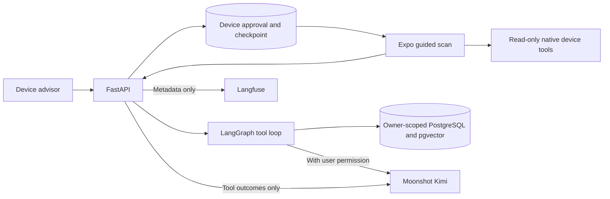

# ProofScan agents

**Device advisor** compares devices in a signed-in user’s private catalog. **Guided scan** selects approved local device checks in Expo. The deterministic inspection graph still compares measurements and listing claims. The verification service controls consent, sharing, and signatures.



## Device advisor

1. Open **Device advisor** at `/advisor` and sign in.
2. Add the devices you are considering, along with specifications or listing notes. You can record the listed price, currency, and a public HTTPS source URL.
3. Ask a question, such as “Which phone in my catalog should I consider for long battery life?” Choose a category and optionally enter a budget and currency.
4. Check the Moonshot consent box if you want an answer from the model using this question and the relevant catalog excerpts. Otherwise the app ranks candidates locally. When the assistant asks for a detail, update the question and submit it again.

The advisor cites catalog evidence and its recorded prices. You can enter specifications from a signed report or retailer listing. Market-wide coverage, real-time prices, and automatic ingestion of private reports are outside this catalog workflow.

### Reasoning, actions, and safeguards

The LangGraph ReAct loop alternates between a typed decision and a tool observation. K3 returns a decision through a required function call. The graph supports the following actions.

| Action | Application policy |
| --- | --- |
| `search_catalog` | The model may suggest terms. PostgreSQL binds the signed-in owner, device category, currency, and budget. |
| `compare_candidates` | Compares records already retrieved within the current request. |
| `recommend` | Requires retrieved evidence and returns citations from that evidence. |
| `clarify` | Pauses for the user to provide more information. |

The provider boundary enforces explicit approval, a ten-second timeout per call, a 24-second decision window, output limits, and a maximum of three calls per recommendation. Unsupported actions, invalid source references, and provider errors use deterministic fallback behavior. A PostgreSQL quota reservation is committed before contacting Moonshot. Execution records contain status and tool metadata. The hourly worker clears older execution records.

Text mode uses PostgreSQL lexical ranking. Semantic mode stores 384-dimensional FastEmbed vectors in pgvector. It applies ownership and price filters before exact cosine similarity, then adds a lexical signal. Existing catalog entries can be reindexed when semantic mode is activated. [pgvector filtering and exact search](https://github.com/pgvector/pgvector#filtering) · [FastEmbed model list](https://qdrant.github.io/fastembed/examples/Supported_Models/)

## Guided scan

1. In Expo, open **Scan device** and paste the original seller link. Give the normal seller consent.
2. Select **Plan guided scan**. Review the proposed scope and select **Approve checks and collect**. You can skip the plan or choose basic collection.
3. The client performs an approved local reader and reports the outcome. The planner uses available tools and earlier outcomes to select the next action. An unavailable model name can trigger an alternate lookup for the operating system’s product code.
4. Review the actual readings before deciding whether to share the report.

The approval, current tool, and revision are checkpointed in PostgreSQL. The server reserves an execution revision before inference and rechecks guest authorization before applying the decision. A short processing lease permits a restart after an interruption. The model receives the platform, approved tool names, and outcome labels. Actual readings go through the existing ProofScan scan API. The tool registry contains fixed, read-only functions. The Windows collector still runs its fixed local CIM fallbacks, including an alternate model lookup. Guided execution is wired into the Android and iOS client.

## Setup

### Base API and Moonshot

Run `uv sync --locked --python 3.12 --no-install-project` and `uv run --no-sync alembic upgrade head` from the repository root.

Put `KIMI_API_KEY` in the ignored server environment. The default provider origin is `https://api.moonshot.ai/v1`. `AGENT_MODEL` defaults to `kimi-k3` with low reasoning effort. `AGENT_TEST_MODEL` defaults to `kimi-k2.6` for a small synthetic test. K2.6 needs access on your account and can be overridden when K2 is retired. The existing listing extraction endpoint uses `KIMI_MODEL`. [Kimi model list](https://platform.kimi.ai/docs/models) · [Kimi pricing and availability](https://platform.kimi.ai/docs/pricing/chat)

Set `PYTHONPATH=apps/api` in the process. In PowerShell use `$env:PYTHONPATH = "apps/api"`. Run the cheap synthetic probe, or add `--production` to test `AGENT_MODEL`.

```sh
uv run --no-sync python -m proofscan.agent probe
```

### Semantic retrieval on host PostgreSQL

Install pgvector for your PostgreSQL major version. Provision it in the same database after applying Alembic. The provisioning SQL expects the extension in `public` and resolves the catalog using the configured database search path. Use a migration role for the SQL and grant the app role the permissions it needs for the catalog, vectors, and execution records.

```sh
uv sync --locked --extra agent --python 3.12 --no-install-project
uv run --no-sync alembic upgrade head
psql -h 127.0.0.1 -U YOUR_MIGRATION_ROLE -d YOUR_DATABASE -v ON_ERROR_STOP=1 -f infrastructure/postgres/enable_agent_vectors.sql
uv run --no-sync python -m proofscan.agent warm
uv run --no-sync python -m proofscan.agent reindex
```

The last two commands need `PYTHONPATH=apps/api`. `warm` caches the public `BAAI/bge-small-en-v1.5` embedding model in `AGENT_EMBEDDING_CACHE` and runs a synthetic inference. `reindex` backfills existing catalog entries. Set `AGENT_VECTOR_ENABLED=true` and restart the API. If semantic mode is enabled without its model or database table, the advisor reports a service error.

### Semantic retrieval with Compose

For a fresh database, set `PROOFSCAN_POSTGRES_IMAGE=pgvector/pgvector:pg17`. Set `PROOFSCAN_INSTALL_AGENT=true` to install the optional agent dependencies in the API image. Plan a compatible migration or restore for any existing database volume before changing its image. Start with semantic mode off, build the stack and let the initializer migrate the database.

```bash
docker compose exec -T db sh -c 'psql -U "$POSTGRES_USER" -d "$POSTGRES_DB" -v ON_ERROR_STOP=1' < infrastructure/postgres/enable_agent_vectors.sql
docker compose run --rm --no-deps api python -m proofscan.agent warm
docker compose run --rm --no-deps api python -m proofscan.agent reindex
```

In PowerShell, use `Get-Content -Raw infrastructure/postgres/enable_agent_vectors.sql | docker compose exec -T db sh -c 'psql -U "$POSTGRES_USER" -d "$POSTGRES_DB" -v ON_ERROR_STOP=1'` for the SQL step. Set `AGENT_VECTOR_ENABLED=true` and run `docker compose up -d`. The cache volume is shared by the warming command and the API.

### Langfuse

Install the optional `agent` extra or the matching API image. Set `LANGFUSE_BASE_URL`, `LANGFUSE_PUBLIC_KEY`, and `LANGFUSE_SECRET_KEY` in the server environment. Restart the API and run a recommendation or guided scan. Look for `proofscan.recommendation` or `proofscan.device` in the configured project’s observations.

Telemetry carries execution ID, model, token counts, tool, outcome, and duration. Questions, prompts, catalog content, measurements, guest credentials, and model responses are excluded. Failed export leaves the app available. [Langfuse Python SDK](https://python.reference.langfuse.com/langfuse)

## API and tests

| Route | Use |
| --- | --- |
| `GET /api/v1/agent/catalog` | List private catalog entries, 30 per page using `offset`. |
| `POST /api/v1/agent/catalog` | Add an owned catalog entry and its vector when enabled. |
| `DELETE /api/v1/agent/catalog/{id}` | Remove an owned entry and its vector. |
| `POST /api/v1/agent/ask` | Ask with optional budget and explicit model permission. |
| `POST /api/v1/guest/{verification_id}/agent/plan` | Pause for approval on an active mobile scan. |
| `POST /api/v1/guest/{verification_id}/agent/plan/{id}` | Submit approval, skip, or report the last tool outcome with the current revision. |

Run `uv run --no-sync pytest -q` with `TEST_DATABASE_URL` set to a disposable test database. Install pgvector in that database and set `TEST_AGENT_VECTOR=1` to exercise vector storage and owner-scoped retrieval. Playwright exercises the advisor through the web app. Physical Android and iOS acceptance follows the [mobile release guide](../development/mobile-release.md).
