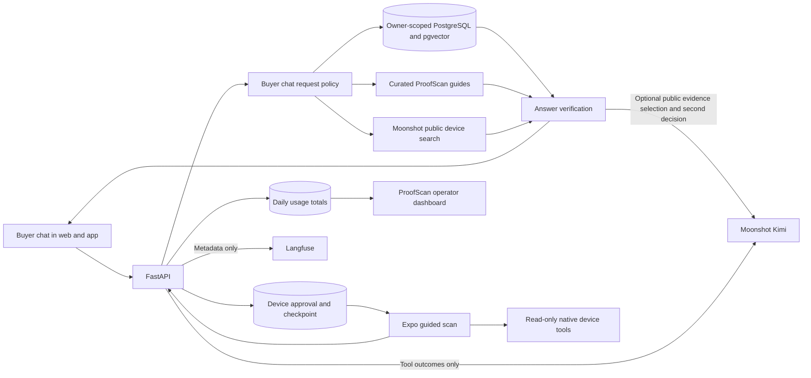

# ProofScan agents

**Buyer chat** answers questions about ProofScan, compares signed reports shared with a buyer and looks up prices and specifications for supported devices. **Guided scan** selects approved local device checks in Expo. The verification service controls consent, report sharing, and signatures.



## Buyer chat

1. Open **Buyer chat** in the web or app workspace and sign in. The default pool is the signed reports sellers shared with your account.
2. Type a question such as “How do I recheck a device at pickup?”, “Which of my phones has the healthiest battery?” or “What does an iPhone 15 Pro cost in India?” Enter sends and Shift+Enter inserts a line break. Chat settings control the default market, public search, saved listings, and the optional model review.
3. Open a cited report, ProofScan guide or retailer source to check the evidence. The app can pass up to four recent user turns to resolve follow-ups such as “What about in the UK?” The conversation stays in the current window. **New chat** clears it, and the server stores no transcript.
4. Public search supports selected iPhone, Galaxy, Pixel, OnePlus, Xiaomi, Redmi, Poco, MacBook and ThinkPad models. It uses a retailer allowlist for India, the United States and the United Kingdom. The search timestamp records when ProofScan looked up the listing. Confirm the current checkout price, configuration and availability at the source.

### Device pricing skill

Ask “What did the iPhone 15 Pro launch at, and how much is a refurbished 128 GB one worth now in India?” The chat runs a bounded retailer search from the recognized model, market and optional storage and condition. The launch lookup can cite stored manufacturer release references for the iPhone 15 Pro family and US Galaxy S24 family. For other supported iPhones, it can search the regional Apple Newsroom and accepts a starting price only when the announcement reliably names the exact model and currency. [Apple Newsroom India](https://www.apple.com/in/newsroom/2023/09/apple-unveils-iphone-15-pro-and-iphone-15-pro-max/) · [Samsung US Newsroom](https://news.samsung.com/us/enter-new-era-of-mobile-ai-samsung-galaxy-s24-series/)

The skill uses integer minor units for prices. It calculates a median and range from verified asking prices in the same condition and storage cohort, with one contribution per retailer and at least two distinct retailers. It withholds the range for sparse or widely divergent evidence. It excludes financing, advertised MSRP, unavailable stock and obvious accessories from the range. The UI shows the retailer count, condition, storage, announcement year, and citations. A launch comparison percentage requires matching base storage. Laptop listing research remains available. The estimator requires a supported phone model with a sufficiently specific configuration.

The range describes indexed asking prices. A current sale price depends on checkout availability, seller terms and the device’s condition. The calculation uses neither a generic depreciation rate nor imagined transactions. The signed report’s simulator and configured sold-comparable pricing continue to use their own data path. Public retailer and launch work runs in parallel within the search timeout, at most four searches for two models. Only validated public options leave ProofScan.

Sharing creates the searchable report entry in the same database transaction. Existing valid shared reports are backfilled in batches when their owner first uses chat. Pending, declined, simulated and invalidated reports are excluded. Invalidating a report removes the entry and its vector. Budget filtering uses the upper bound of a stored comparable price estimate when available. Inspect the source report for the full estimate or an explanation of missing data.

The automatic index contains a scrubbed manufacturer and model, the device category, measured RAM, storage and battery health when available, claim mismatch and photo counts, and any supported price estimate. It excludes the report label and notes, identifiers, images, and guest links. Buyer Chat uses the signed-in owner from the session and rechecks citation ownership before rendering. Free-text questions, listing text, private URLs, photos and reports stay inside ProofScan.

### Reasoning, actions, and safeguards

The scope gate selects a ProofScan guide, an owner-scoped report comparison, or public device research. It declines unrelated and restricted requests before any lookup. The search client constructs its query from a recognized model and market. It limits time, response size and domains, strips URL tracking data, checks model variants, and only displays an extracted price if it identifies a single local-currency amount. Retailer snippets are untrusted input. ProofScan extracts bounded fields and discards the raw text before building an answer.

Every response uses application-owned copy and validated evidence. With optional model review on, a first Moonshot call selects evidence IDs from curated product facts or bounded public search facts. A separate reviewer call can remove IDs. The application intersects the review with the original selection and directs an empty review to a clarification. If either provider call fails, the application can use its independently validated evidence. Private comparisons use the local verifier throughout. [OWASP prompt injection guidance](https://genai.owasp.org/llm2026/llm012026-prompt-injection/) · [OWASP output handling guidance](https://genai.owasp.org/llm2026/llm102026-improper-output-handling/)

The compatibility endpoint `/agent/ask` retains the existing LangGraph ReAct recommendation loop and its structured comparison contract. Both routes reserve a shared daily quota before provider work. Execution records contain status and tool metadata. The hourly worker clears older execution records.

Text mode uses PostgreSQL lexical ranking. Semantic mode stores 384-dimensional FastEmbed vectors in pgvector. It filters eligible records before exact cosine similarity and combines that score with a lexical signal. New report vectors are built locally during retrieval in bounded batches. The reindex command also fills missing vectors. [pgvector filtering and exact search](https://github.com/pgvector/pgvector#filtering) · [FastEmbed model list](https://qdrant.github.io/fastembed/examples/Supported_Models/)

## Capture guidance and operator usage

New purchase checks require internal readings and clear front and back photos. The buyer can create a private pickup recheck from the original signed report. At handoff and return, ProofScan suggests the next view, checks uploaded photo quality and shows matching-angle feedback. See the [capture and recheck walkthrough](../ux/flows.md#picture-guidance-and-pickup-rechecks).

The operator dashboard shows totals over the latest 30 UTC days for requests, completed responses or checks, model calls, and token usage. The breakdown covers buyer chat, guided device checks, purchase photos and handoff photos. The daily counters contain no account identifiers, questions, model responses or images. Operator access requires the existing admin role. The dashboard works with Langfuse disabled.

## Guided scan

1. In Expo, open **Scan device** and paste the original seller link. Give the normal seller consent.
2. Select **Plan guided scan**. Review the proposed scope and select **Approve checks and collect**. You can skip the plan or choose basic collection.
3. The client performs an approved local reader and reports the outcome. The planner uses available tools and earlier outcomes to select the next action. An unavailable model name can trigger an alternate lookup for the operating system’s product code.
4. Review the actual readings before deciding whether to share the report.

The approval, current tool, and revision are checkpointed in PostgreSQL. The server reserves an execution revision before inference and rechecks guest authorization before applying the decision. A short processing lease permits a restart after an interruption. The model receives the platform, approved tool names, and outcome labels. Actual readings go through the existing ProofScan scan API. The tool registry contains fixed, read-only functions. The Windows collector still runs its fixed local CIM fallbacks, including an alternate model lookup. Guided execution is wired into the Android and iOS client.

## Setup

### Base API and Moonshot

Run `uv sync --locked --python 3.12 --no-install-project` and `uv run --no-sync alembic upgrade head` from the repository root.

Put `KIMI_API_KEY` in the ignored server environment. The default provider origin is `https://api.moonshot.ai/v1`. `AGENT_MODEL` defaults to `kimi-k3` with low reasoning effort. `AGENT_TEST_MODEL` defaults to `kimi-k2.6` for a small synthetic test. K2.6 needs access on your account and can be overridden when K2 is retired. The existing listing extraction endpoint uses `KIMI_MODEL`. [Kimi model list](https://platform.kimi.ai/docs/models) · [Kimi pricing and availability](https://platform.kimi.ai/docs/pricing/chat)

Public device research requires Moonshot Web Search Basic access on the configured key. Search is billed by the provider. Set `AGENT_REVIEW_MODEL` to choose the separate reviewer model. It defaults to `kimi-k2.6`. Chat can use guides, private reports and available published launch references when public search is unavailable. [Kimi Web Search guide](https://platform.kimi.ai/docs/guide/best-practices-for-web-search)

Set `PYTHONPATH=apps/api` in the process. In PowerShell use `$env:PYTHONPATH = "apps/api"`. Run the cheap synthetic probe, or add `--production` to test `AGENT_MODEL`.

```sh
uv run --no-sync python -m proofscan.agent probe
```

### Semantic retrieval on host PostgreSQL

Install pgvector for your PostgreSQL major version. Provision it in the same database after applying Alembic. The provisioning SQL expects the extension in `public` and resolves the catalog using the configured database search path. If the API and worker use roles separate from the table owner, configure database grants and row-level policies for those server roles on the protected tables they use. Keep the browser-facing roles excluded.

```sh
uv sync --locked --extra agent --python 3.12 --no-install-project
uv run --no-sync alembic upgrade head
psql -h 127.0.0.1 -U YOUR_MIGRATION_ROLE -d YOUR_DATABASE -v ON_ERROR_STOP=1 -f infrastructure/postgres/enable_agent_vectors.sql
uv run --no-sync python -m proofscan.agent warm
uv run --no-sync python -m proofscan.agent reindex
```

The last two commands need `PYTHONPATH=apps/api`. `warm` caches the public `BAAI/bge-small-en-v1.5` embedding model in `AGENT_EMBEDDING_CACHE` and runs a synthetic inference. `reindex` backfills existing catalog entries. Set `AGENT_VECTOR_ENABLED=true` and restart the API. If the model or vector table is unavailable, Buyer Chat uses text ranking with the same access and budget filters. Execution metadata records the ranking mode.

### Semantic retrieval with Compose

For a fresh database, set `PROOFSCAN_POSTGRES_IMAGE=pgvector/pgvector:pg17`. Set `PROOFSCAN_INSTALL_AGENT=true` to install the optional agent dependencies in the API image. Plan a compatible migration or restore for any existing database volume before changing its image. Start with semantic mode off, build the stack and let the initializer migrate the database.

```bash
docker compose exec -T db sh -c 'psql -U "$POSTGRES_USER" -d "$POSTGRES_DB" -v ON_ERROR_STOP=1' < infrastructure/postgres/enable_agent_vectors.sql
docker compose run --rm --no-deps api python -m proofscan.agent warm
docker compose run --rm --no-deps api python -m proofscan.agent reindex
```

In PowerShell, use `Get-Content -Raw infrastructure/postgres/enable_agent_vectors.sql | docker compose exec -T db sh -c 'psql -U "$POSTGRES_USER" -d "$POSTGRES_DB" -v ON_ERROR_STOP=1'` for the SQL step. Set `AGENT_VECTOR_ENABLED=true` and run `docker compose up -d`. The cache volume is shared by the warming command and the API.

### Langfuse

Install the optional `agent` extra or the matching API image. Set `LANGFUSE_BASE_URL`, `LANGFUSE_PUBLIC_KEY`, and `LANGFUSE_SECRET_KEY` in the server environment. Restart the API and run a recommendation or guided scan. Look for `proofscan.recommendation` or `proofscan.device` in the configured project’s observations.

Telemetry carries execution ID, model, token counts, tool, outcome, and duration. Questions, prompts, catalog content, measurements, guest credentials, and model responses are excluded. Failed export leaves the app available. [Langfuse Python SDK](https://python.reference.langfuse.com/langfuse)

## API and tests

| Route | Use |
| --- | --- |
| `GET /api/v1/agent/catalog` | List private catalog entries, 30 per page using `offset`. |
| `POST /api/v1/agent/catalog` | Add an owned catalog entry and its vector when enabled. |
| `DELETE /api/v1/agent/catalog/{id}` | Remove an owned entry and its vector. |
| `POST /api/v1/agent/chat` | Send a free-text message with optional recent user turns and search settings. Returns a checked answer, status and citations. |
| `POST /api/v1/agent/ask` | Compatibility route for structured catalog recommendations with an optional budget, report-only filter and previous question. |
| `GET /api/v1/admin/agent-usage` | Read 30 UTC days of aggregate usage as an operator. |
| `POST /api/v1/verifications/{verification_id}/recheck` | Create an owner-only private pickup check from a valid device report. |
| `POST /api/v1/guest/{verification_id}/agent/plan` | Pause for approval on an active mobile scan. |
| `POST /api/v1/guest/{verification_id}/agent/plan/{id}` | Submit approval, skip, or report the last tool outcome with the current revision. |

Run `uv run --no-sync pytest -q` with `TEST_DATABASE_URL` set to a disposable test database. Install pgvector in that database and set `TEST_AGENT_VECTOR=1` to exercise vector storage and owner-scoped retrieval. Playwright exercises the advisor through the web app. Physical Android and iOS acceptance follows the [mobile release guide](../development/mobile-release.md).
