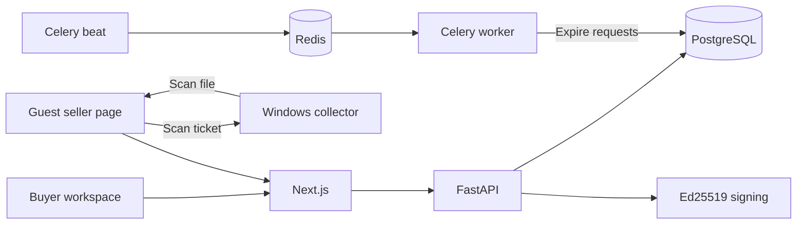

# Architecture

ProofScan is a modular monolith. The browser uses a same-origin Next.js proxy to reach the FastAPI app. FastAPI owns authentication, state transitions, report rendering inputs and signing. The Windows collector reads local hardware and produces a bounded file tied to the short-lived ticket.

Buyer accounts use local auth for development. Supabase authentication uses the hosted project's asymmetric JWKS when configured. The PostgreSQL connection can target a compatible Supabase database. These hosted paths require live project configuration to validate.

Status changes and notifications share a transaction. A verification row lock serializes guest submissions, decisions and revocations. Request expiry is enforced during guest authorization, even if the worker is unavailable.

The inspection graph reads validated hardware and private photo metadata. OpenCV checks exterior JPEG brightness and sharpness, resizes the image and strips metadata by re-encoding it. The local database stores processed photos. The worker clears image bytes after the configured retention period, while signed digests remain in reports. Handoffs use a separate state machine and sign their own comparison payloads.

The [threat model](../security/threat-model.md) identifies the trust boundary for a collector response.
